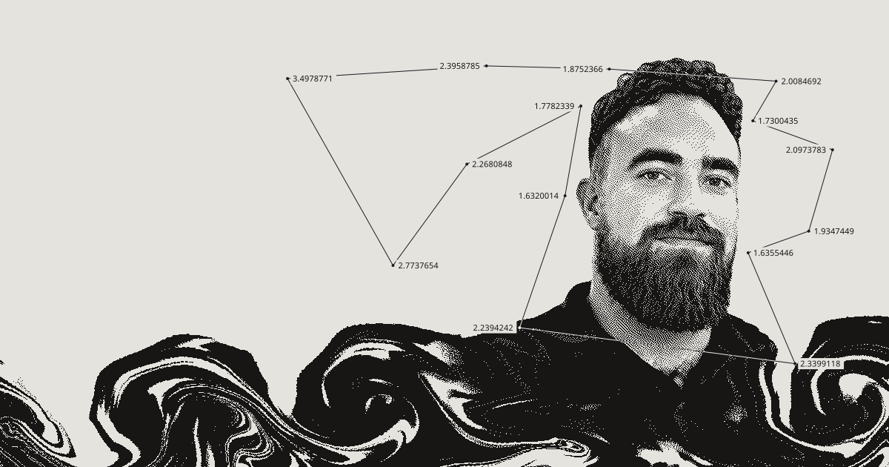

Senior full-stack developer in Helsinki, building LLM systems.

Recent: [nolla-assistant](https://github.com/ahulkkonen/nolla-assistant), a self-hosted assistant with Finnish PII masking.

More at [hulkko.dev](https://hulkko.dev), [LinkedIn](https://www.linkedin.com/in/ahulkkonen).
