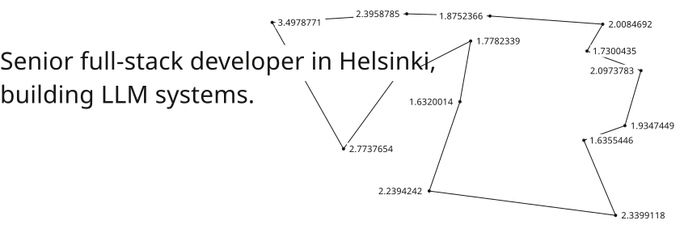

<a href="https://hulkko.dev"><picture><source media="(prefers-color-scheme: dark)" srcset="line-dark.svg"></picture></a>

Recent: [nolla-assistant](https://github.com/ahulkkonen/nolla-assistant), a self-hosted assistant with Finnish PII masking.

More at [hulkko.dev](https://hulkko.dev), [LinkedIn](https://www.linkedin.com/in/ahulkkonen).
